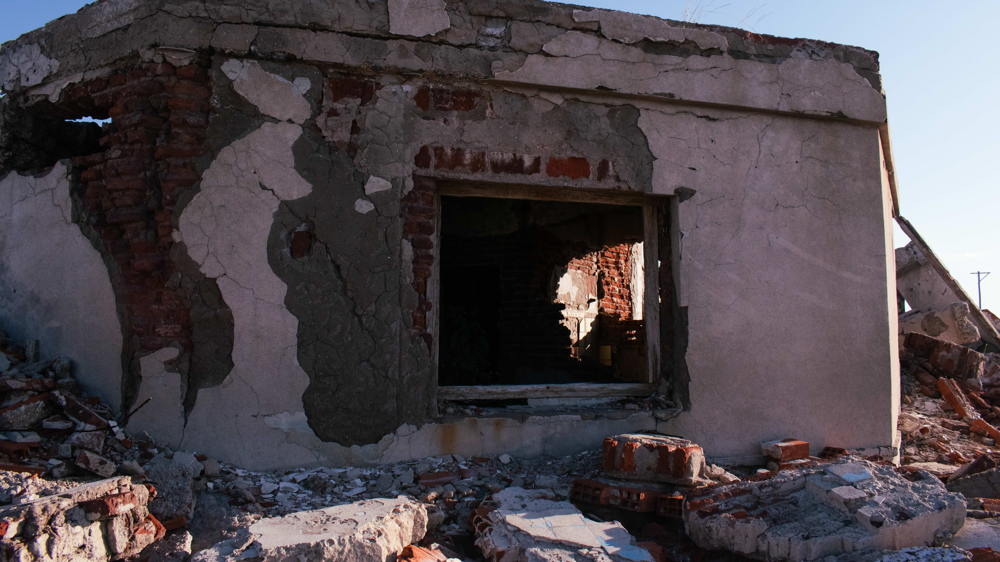
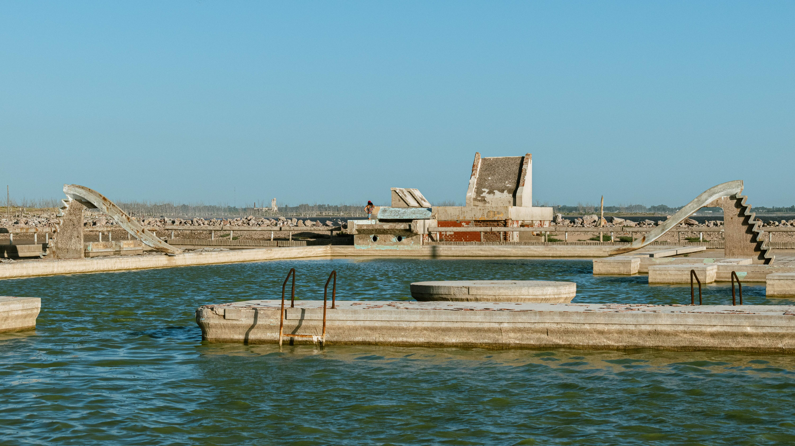
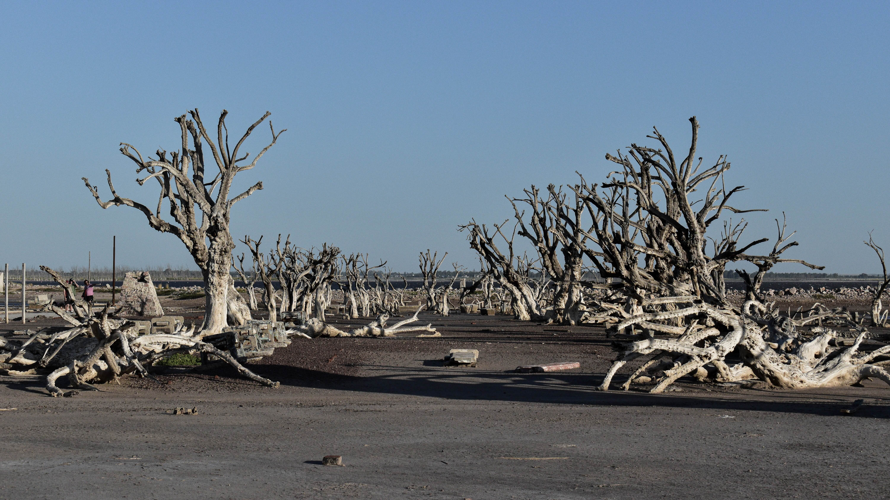
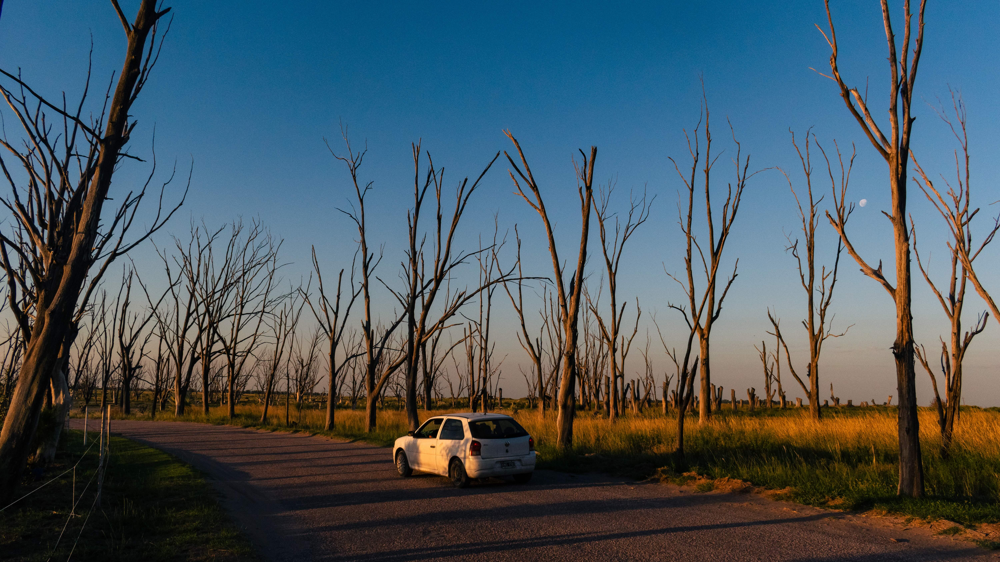

# Visiting an Argentinian ghost town

Villa Epecuen, a town about 600km from Buenos Aires was once a popular weekend getaway for Argentinians. Situated next to the Lake Epecuen, it used to boast of numerous hotels and resorts. However, the 1980s saw an increase in rainfall which led to rising water levels. Eventually in November 1985, a dam nearby broke, flooding the entire village. The water levels continued to rise in the next few years, and the town remained under water for 25 years. At its lowest, it was 10 meters under water. Finally in 2009, the waters started to recede. Today, it is officially declared as a deserted village, with no inhabitants living there.

It is open for tourism now, and I was fortunate to visit it and explore the ruins in the Spring of 2025. Walking around it gives you a very eerie, post apocalyptic feeling. When you enter the town, there is a main road that leads you to the lake, with remnants of former bustling establishments everywhere. You would be forgiven for mistaking it for a warzone.

Towards the end of the main road, you will find a swimming pool. It gives you a sense of what the atmosphere was like there during its heyday. You can imagine families laying by the pool while their kids slide down or jump into the water.

Another distinctive feature of the town is the dead trees. They are everywhere!

Finally, the most iconic feature of Villa Epecuen is the slaughterhouse. It is the image you see at the very top of this blog post. El Matadero (which literally translates to slaughterhouse in Spanish) is about a 5 minute drive from the town itself. It is the tallest structure you will see in the area, and beautifully sticks out against the night sky.

Finally to recap my visit, I consider it to be one of the more memorable parts of my Argentina visit. This is the first time I have seen modern ruins. On the one hand I was able to appreciate the macabre beauty of the place, but on the other hand it was a reminder of how delicate our built world truly is.
